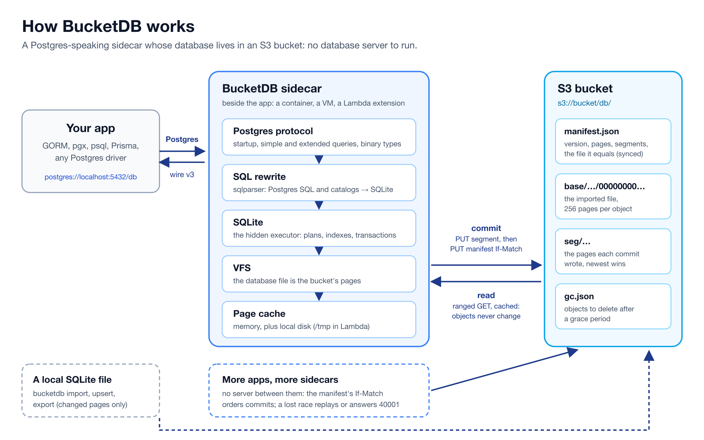

# BucketDB

**A Postgres database that lives in an S3 bucket, served by a sidecar.**

BucketDB runs beside your app (a container, a VM, a Lambda extension) and speaks the
Postgres wire protocol on `localhost`. Your app connects with the driver and ORM it
already uses (pgx, GORM, psql, Prisma...) and writes Postgres SQL. Underneath, the
database is a set of immutable objects in a bucket: there is no database server to
run, patch, scale or pay for while idle. Many sidecars can serve the same database;
the bucket's conditional writes order their commits.

<p align="center">
  
</p>

Inside, one small binary (4.7 MB on macOS, ~5 MB static for Linux):

```
Postgres wire ──▶ sqlparser AST ──▶ rewritten for SQLite ──▶ SQLite ──▶ VFS ──▶ S3
   (pg.rs)          (sql.rs)          (sql.rs, types.rs)               (vfs.rs, store.rs, s3.rs)
```

SQLite is the executor nobody sees: it plans and runs the queries, but the app never
writes SQLite SQL and never sees a SQLite file. The VFS turns SQLite's file into
pages fetched from the bucket and cached, and a commit into new objects plus one
conditional swap of the manifest.

**Good for** read-mostly databases and modest write rates: APIs over reference data,
per-tenant or per-app databases, functions that need SQL without a server.
**Not for** high write throughput: every commit is two S3 PUTs (~20-50 commits/s on
AWS S3 across all sidecars of a database).

## Quick start

```sh
cargo build --release
export AWS_ACCESS_KEY_ID=... AWS_SECRET_ACCESS_KEY=...   # BUCKETDB_S3_ENDPOINT for MinIO, R2...

bucketdb import app.sqlite s3://my-bucket/app     # or: bucketdb create s3://my-bucket/app
bucketdb serve s3://my-bucket/app                 # postgres://localhost:5432/app
psql postgres://postgres@localhost:5432/app -c 'select count(*) from users'
```

## Layout in the bucket

```
<db>/manifest.json            version, page size and count, base, chunks, segments, synced
<db>/base/<id>/<chunk:08>     the imported file (or a compaction's rewrite), 256 pages each
<db>/seg/<version:012>-...    the pages one commit changed
```

- **Read**: a transaction takes a snapshot of the manifest when it starts (checked
  with the bucket at most every `BUCKETDB_STALENESS_MS`, a 304 when unchanged). A page
  is in the newest segment that lists it, else in the base; it is fetched with a
  ranged GET (16 pages of read-ahead from the base) and kept in a cache. Objects
  never change, so a cached page is never stale.
- **Write**: SQLite is built with `SQLITE_ENABLE_BATCH_ATOMIC_WRITE` and the VFS
  claims `SQLITE_IOCAP_BATCH_ATOMIC`, so a commit hands its pages over in one batch.
  The VFS writes them as a segment, then PUTs the manifest with `If-Match` on the
  ETag the transaction started from. When another commit got there first, the
  transaction is replayed over it if the winner wrote none of the pages this one
  read or wrote (page 1's counters are merged; a schema change never is). Otherwise
  it gets `40001 serialization_failure` and runs again, as ORMs do on their own. To
  know what a transaction read, each one sees its own change counter in page 1, so
  SQLite drops its page cache at every start and every page comes through the VFS
  (from BucketDB's cache). A
  transaction too big for SQLite's cache spills to a local rollback journal; then the
  sync of the main file commits (a rollback's playback, equal to the snapshot, sends
  nothing).
- **Compaction**: once the manifest lists `BUCKETDB_COMPACT_SEGMENTS` segments, a
  sidecar folds them into the chunks they touch, written anew under a prefix of its
  own, and swaps the manifest (commits that land meanwhile are kept). The objects it
  replaced are listed as retired and deleted by a later compaction once older than
  `BUCKETDB_GRACE_SECONDS`, so a transaction still reading them is safe.
- **Cache**: pages in memory (sharded CLOCK, `BUCKETDB_CACHE_MB`), and on local disk when
  `BUCKETDB_DISK_CACHE_DIR` is set (Lambda's `/tmp`), bounded by `BUCKETDB_DISK_CACHE_MB`.
- **Locks** are per process: readers never wait (they read their snapshot), one
  connection at a time writes. Between sidecars, the manifest's If-Match is all.

## The Postgres side

- Protocol v3: startup (trust, or a cleartext password with `BUCKETDB_PASSWORD`),
  simple queries, and the extended protocol drivers use (Parse/Bind/Describe/Execute/
  Sync/Close/Flush), with binary parameters and results for bool, int2/4/8,
  float4/8, numeric, text, bytea, date, timestamp(tz), uuid, json(b); portals with
  a row limit (PortalSuspended); savepoints, and ROLLBACK TO leaving an aborted
  transaction as Postgres does.
- SQL: parsed by sqlparser (Postgres dialect) and printed back for SQLite. Rewritten:
  casts (`::text`, `CAST`), `ILIKE`, `public.` names, `FOR UPDATE`, CREATE TABLE's
  types and serial keys (to `INTEGER PRIMARY KEY`), expression defaults, index
  methods, ALTER TABLE ADD COLUMN, ADD CONSTRAINT UNIQUE (a unique index);
  unnamed select-list expressions get Postgres' names (`count`, the cast operand's).
  `$1` stays: SQLite takes it as a parameter. RETURNING and ON CONFLICT are SQLite's
  own. SET, SHOW, DISCARD, CREATE EXTENSION are session-level no-ops; ALTER COLUMN
  TYPE / SET DEFAULT are no-ops too (SQLite columns are typeless).
- Catalogs: per-connection views of `information_schema` (tables, columns,
  table_constraints, constraint_column_usage) and `pg_catalog` (pg_class,
  pg_attribute, pg_attrdef, pg_index, pg_constraint, pg_type, pg_namespace,
  pg_database, pg_indexes...) over SQLite's schema, with format_type(),
  pg_get_indexdef(), pg_get_constraintdef() and the `~` operators: what GORM's
  AutoMigrate reads, and psql's `\l`, `\dn`, `\d`, `\dt`, `\di`, `\d table` and
  `\d+ table` (columns, defaults, indexes, foreign keys both ways). Indexes take
  Postgres' names (`t_pkey`, `t_col_key`); there are no triggers, policies or
  partitions to show.
- Types: a column keeps its Postgres type as its declared type; that decides the OID.
  Booleans are 1/0, timestamps UTC text, so they sort as they compare. A parameter's
  type comes from the column it meets (`col = $1`, `IN`, `BETWEEN`, INSERT, UPDATE
  SET, LIMIT/OFFSET).
- Functions SQLite lacks: now(), version(), current_schema(), current_database(),
  lpad, rpad, left, right, gen_random_uuid(), pg_sleep.
- Timestamps with an offset are stored in UTC.

Tested with GORM over pgx: a Go API, unchanged, answers byte for byte as on a
regular server over a 38 GB database; `tests/gorm` runs AutoMigrate
(create, no-op, add column), CRUD, Preload, a nested transaction (savepoint),
numeric, timestamptz, uuid defaults, ILIKE, LIMIT/OFFSET.

## Use

A database in the bucket is always written `s3://bucket/path`; any other argument
is a local file.

```sh
export BUCKETDB_S3_ENDPOINT=http://127.0.0.1:9100   # omit for AWS
export AWS_ACCESS_KEY_ID=... AWS_SECRET_ACCESS_KEY=...

bucketdb import data/app.sqlite s3://bucket/app      # upload a SQLite file as a database
bucketdb create s3://bucket/app                      # or start an empty one
bucketdb serve --port 5432 s3://bucket/app           # postgres://localhost/app
bucketdb compact s3://bucket/app                     # fold the segments now
```

### Updating from a file

For a database refreshed from outside (a monthly dump, say) rather than by an app:

```sh
bucketdb export s3://bucket/app published.sqlite     # download, and pin that version
cp published.sqlite updated.sqlite                   # change the copy with SQLite
sqlite3 updated.sqlite < changes.sql
bucketdb upsert published.sqlite updated.sqlite s3://bucket/app
bucketdb import --replace rebuilt.sqlite s3://bucket/app   # or swap the whole file
```

`upsert` compares the two files page by page and commits only the pages that differ,
as one version, reading nothing from the bucket. The manifest records the SHA-256 of
the file the bucket equals (`synced`, set by import, export and upsert); upsert
refuses a base that is not that file, and any commit through a sidecar clears it.
The copy must be changed in place (SQL on it): a file built anew lays its pages out
anew and differs everywhere. `import --replace` uploads a new base and swaps the
manifest; readers move at their next transaction, and the old objects go after the
grace period. `export` downloads the whole database: free inside AWS in the bucket's
region, not from outside it.

Tuning: `BUCKETDB_CACHE_MB` (64), `BUCKETDB_READAHEAD` (16 pages),
`BUCKETDB_STALENESS_MS` (1000), `BUCKETDB_CHUNK_PAGES` (256),
`BUCKETDB_DISK_CACHE_DIR`, `BUCKETDB_DISK_CACHE_MB` (1024),
`BUCKETDB_COMPACT_SEGMENTS` (100), `BUCKETDB_GRACE_SECONDS` (600), `BUCKETDB_REPLAY` (on),
`BUCKETDB_LOG`.

Limits: `BUCKETDB_MAX_CONNECTIONS` (64; one more gets `53300`), `BUCKETDB_MAX_TXN_MB`
(256; a transaction writing more gets `54000` and rolls back, instead of growing
memory).

## AWS Lambda

BucketDB runs as an external extension: put the binary at `/opt/extensions/bucketdb`
(a layer, or `COPY` in a container image) and set `BUCKETDB_DATABASES=s3://bucket/app` plus the
S3 variables (in AWS, the function role's credentials are already in the environment).
Lambda starts it before the function with no arguments; it opens `127.0.0.1:5432`,
then registers with the Extensions API (for `SHUTDOWN` only), and only then does the
function's init go on. Between invocations it is frozen with the function; on
shutdown there is nothing to flush, a commit is in the bucket before the app hears of it.

It shares the function's memory, so in Lambda the defaults follow
`AWS_LAMBDA_FUNCTION_MEMORY_SIZE` (any of them can still be set):

| | default in Lambda (1024 MB function) |
|---|---|
| page cache | a quarter of the memory (256 MB) |
| a transaction's writes | a quarter (256 MB) |
| connections | one per 32 MB, 8 to 64 (32), ~2 MB of SQLite cache each |
| disk cache | `/tmp/bucketdb/cache`, half of `/tmp`'s free space |
| placeholders, temp files | `/tmp/bucketdb/db`, `TMPDIR=/tmp` |

The disk cache is not a copy of the database: one sparse file per bucket object,
holding only the pages read, and wiped when the extension starts.

Build for Lambda (arm64; use an amd64 machine or `--platform` for x86_64):

```sh
podman run --rm -v $PWD:/src -w /src rust:1-alpine sh -c 'apk add musl-dev && cargo build --release'
```

Tested in the Lambda runtime interface emulator (`public.ecr.aws/lambda/python:3.12`,
BucketDB in `/opt/extensions`, pg8000 in the function) over the 38 GB CNPJ
database in MinIO: init 53 ms, first lookup 36 ms, cached 0.4 ms, BucketDB's RSS 7 MB.

`cargo build --release`: opt-level s, fat LTO, stripped.

## Development

```sh
make check    # clippy (pedantic), rustdoc, tests, rustfmt: what CI runs
make gorm     # GORM over pgx, end to end, against a local MinIO
```

`run-local.sh` starts a local MinIO and serves a database from it on :5460.
See [AGENTS.md](AGENTS.md) for the conventions (English, Conventional Commits).

## Not yet

- CHECK constraints in `\d table`, and psql's other `\d` commands (functions, types, roles).
- Arrays, interval arithmetic, COPY, LISTEN/NOTIFY, generate_series.
- A foreign key or check added with ALTER TABLE is accepted but not enforced
  (SQLite only takes constraints in CREATE TABLE); one in CREATE TABLE is.
- A transaction that started before a compaction cannot be replayed after it: it
  conflicts and runs again. A schema change conflicts with every concurrent commit.
- A transaction's pages are held in memory until commit (bounded by
  `BUCKETDB_MAX_TXN_MB`).
- Unix only; tested against MinIO (AWS S3 has conditional PUTs since late 2024).
